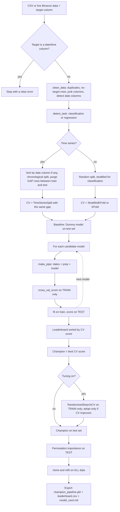
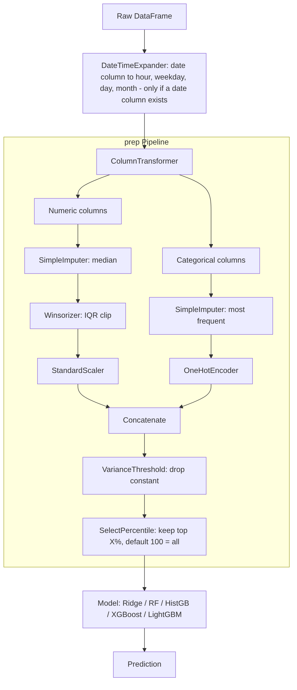

# 🤖 AutoML Studio — XRP/USDT

An end-to-end AutoML app built with Streamlit. A non-technical user uploads a CSV (or pulls live XRP/USDT candles from Binance), picks a target column, and gets a fully trained, compared and ready-to-use **champion model** as a single downloadable `.pkl` file, with no code. A **Predict** page then applies the model to the latest live candles or to a new CSV.

> ⚠️ **Disclaimer:** this is a learning/engineering project, not financial advice. Short-term price-return prediction is close to random; the app shows a baseline next to every metric and warns you when a model is no better than predicting the average.

---

## ✨ Features

- **Two data sources:** upload a `.csv`, or fetch live XRP/USDT history from Binance.
- **Live Market page:** candlestick chart, last price, change and volume, with a selectable interval.
- **Automatic task detection:** classification or regression, with a manual override.
- **Automatic cleaning:** duplicates, rows with no target, constant / ID-like / mostly-empty columns, numeric-looking text converted to numbers.
- **Date/time columns handled:** detected automatically, expanded to hour / weekday / day / month, and rows sorted chronologically for time-series runs.
- **Automatic preprocessing:** missing-value imputation, outlier clipping, scaling, one-hot encoding and optional feature selection.
- **Multiple models compared** with cross-validation (optionally XGBoost and LightGBM), then a **Champion** is picked.
- **Optional hyperparameter tuning** of the champion (random search on training data only; adopted only if it improves).
- **Leakage-safe time-series evaluation:** chronological split with a *purge gap* between train and test and between CV folds.
- **Honest evaluation:** a baseline (predict the mean / most common class) is shown next to the test metrics.
- **Explainability:** permutation feature importance on unseen test data.
- **Market evaluation:** directional accuracy and a simple fee-aware long/flat backtest vs. buy-and-hold.
- **Visuals:** correlation matrix, plus a confusion matrix (classification) or actual-vs-predicted scatter plot (regression).
- **Predict page:** use the session's champion or a saved `.pkl`; predict on the latest live candles or a new CSV.
- **Export:** the whole pipeline (preprocessing + model) as one `.pkl`, plus the leaderboard (`.csv`) and a model card (`.md`).

---

## 🚀 Quick start

Requires **Python 3.10+**. Developed and tested with pandas 3.0, scikit-learn 1.9 and Streamlit 1.66.

```bash
pip install -r requirements.txt          # core: everything the app needs
pip install -r requirements-extra.txt    # optional: XGBoost + LightGBM
streamlit run app.py
```

Then open http://localhost:8501.

> **Slow or unstable internet?** Install the core first and run the app; XGBoost/LightGBM are optional and can be added later. `requirements-extra.txt` uses `xgboost-cpu` (≈6 MB) instead of `xgboost`, whose Linux wheel pulls a ≈300 MB NVIDIA GPU library (`nvidia-nccl`) that CPU use does not need. For flaky connections add `--default-timeout=100 --retries 10` to `pip install`.

To open it from another device on the same network:

```bash
streamlit run app.py --server.address 0.0.0.0
```

Run the tests:

```bash
pip install -r requirements-dev.txt
pytest -q
```

---

## 🧭 How to use

### Live Market page
Pick an interval (1m–1d) and number of candles to see the XRP/USDT market. Data is cached for 60 seconds; use **Refresh** to reload.

### Model Dashboard page
1. **Data**
   - *Upload CSV*, or
   - *Live market (XRP/USDT)*: choose interval, history (30/90/180 days) and how many candles ahead to predict. Pick **regression** (future return) or **classification** (UP / DOWN / NEUTRAL with a threshold), then click *Fetch & prepare live data*.
2. **Target & settings**
   - Choose the target column; the detected task is shown. A date/time column is refused as a target.
   - *Advanced:* task override, time-series split, **purge gap**, test size, CV folds, feature-selection %, outlier fence, **optional extra models** (XGBoost, LightGBM) and **hyperparameter tuning**.
3. **Run AutoML**
4. **Results:** cleaning report, champion and metrics vs. baseline, leaderboard, tuning summary, feature importance, correlation matrix, confusion matrix or scatter plot, and (for live future-return models) the market evaluation.
5. **Export:** `champion_pipeline.pkl`, `leaderboard.csv`, `model_card.md`.

### Predict page
1. Choose the model: the champion trained in this session, or upload a `.pkl`.
2. Choose the data:
   - **Latest live candles:** fetches recent XRP/USDT candles, builds the same features and shows the prediction for the latest closed candle (for future-return models, also the implied price).
   - **CSV with new data:** predicts every row and lets you download the predictions. If the file contains the target column, metrics are shown too.

> Only load `.pkl` files you created or trust: a pickle file can run code when it is loaded.

---

## ⚙️ How it works

| Stage | What happens |
|---|---|
| **Task detection** | Non-numeric / boolean target → classification. Integer target with ≤10 unique values (or <2% unique) → classification. Otherwise regression. A date/time target is rejected. |
| **Cleaning** | `inf` → NaN; drop duplicates; drop rows with missing target; drop columns that are >60% missing, constant, or ID-like text; convert numeric-looking text to numbers; detect date columns and keep them. |
| **Dates** | `DateTimeExpander` (inside the pipeline) turns a date column into hour, weekday, day and month, so the exported model accepts the raw date column. |
| **Preprocessing** (inside one sklearn `Pipeline`, learned on training data only) | Numeric: median impute → IQR outlier clipping (`Winsorizer`) → `StandardScaler`. Categorical: most-frequent impute → `OneHotEncoder` (rare categories grouped). Then `VarianceThreshold` → `SelectPercentile` (`f_classif` / `f_regression`; default 100% = keep all). |
| **Split** | Random (stratified for classification), or chronological when *time series* is ticked. In a time series the last `gap` training rows are skipped, because a target that looks N candles ahead overlaps the next N rows. The same gap is used between CV folds. |
| **Model selection** | Models are ranked by cross-validation on the **training set only** (F1-macro for classification, RMSE for regression; `TimeSeriesSplit` for time series). The best is the **Champion**; test metrics are computed on unseen data. |
| **Tuning (optional)** | `RandomizedSearchCV` over the champion's hyperparameters (and the feature-selection %) on the training set; the tuned model replaces the champion only if its CV score is better. |
| **Importance** | Permutation importance on the test set, on the raw columns. |
| **Export** | The champion is refit on all data and saved with `joblib`. |

### Architecture diagrams

**Full AutoML run (`app`)**



**Inside one pipeline (dates + preprocessing + model)**



### Models

| | Classification | Regression |
|---|---|---|
| Linear | LogisticRegression | Ridge |
| Trees | RandomForest | RandomForest |
| Boosting | HistGradientBoosting | HistGradientBoosting |
| Optional | XGBoost, LightGBM | XGBoost, LightGBM |

XGBoost and LightGBM are optional: if they are not installed the app still works and skips them with a warning. Class imbalance is handled with balanced class weights (XGBoost via balanced sample weights).

### Metrics
- **Classification:** Accuracy, Balanced Accuracy, F1 (macro).
- **Regression:** MAE, RMSE, R².
- **Market evaluation (future-return models):** directional accuracy vs. the majority-direction baseline; long/flat backtest on non-overlapping periods with a per-side fee, compared to buy-and-hold, with win rate and max drawdown.

---

## 📈 Live-market features

`build_market_features` builds these features from Binance candles (each uses only past candles, which is covered by a test):

- Returns over 1, 3, 6 and 12 candles
- Price ratio to the 5- and 20-candle moving averages
- 10-candle volatility
- RSI (7 and 14)
- Candle range and body ratio
- Volume change

**Target:** `close[t+N] / close[t] − 1` (regression), or UP / DOWN / NEUTRAL by a threshold (classification). Raw open/high/low/close/volume levels are dropped because they are non-stationary and would let the model "cheat". Live data always uses a chronological split with a purge gap equal to the horizon.

Candles come from the public Binance endpoint `https://data-api.binance.vision/api/v3/klines` (no API key needed), paginated, with the still-open candle removed.

---

## 📦 Using the exported model

```python
import joblib
import pandas as pd

bundle = joblib.load("champion_pipeline.pkl")   # keep automl_engine.py importable
new_df = pd.read_csv("new_data.csv")

pred = bundle["pipeline"].predict(new_df[bundle["feature_columns"]])
```

The bundle contains: `pipeline`, `task`, `target`, `feature_columns`, `champion`, `meta` (data source, interval and horizon for live-market models).

Notes:
- `automl_engine.py` must be importable when loading, because the pipeline uses the custom `Winsorizer` and `DateTimeExpander`.
- If the champion is XGBoost or LightGBM, those packages must be installed where you load it.
- Use the same scikit-learn version that trained the model.

---

## 🗂 Project structure

```
automl.py       # ML logic: detection, cleaning, preprocessing, models, tuning, export, Binance helpers
app.py       # Streamlit UI (Live Market, Model Dashboard, Predict)
requirements.txt       # core dependencies
requirements-extra.txt # optional: XGBoost (CPU) + LightGBM
requirements-dev.txt   # + pytest
tests/
└── test_engine.py     # unit and end-to-end tests for the engine
README.md
docs/
├── pipeline_flow.png      # diagram: dates + preprocessing + model pipeline
└── run_automl_flow.png    # diagram: full AutoML run
```

---

## ⚠️ Known limitations

- Fixed search space for tuning, and a fixed number of trials you choose; no early stopping.
- Outlier clipping uses a fixed IQR rule, with no per-column control.
- Date columns are expanded to calendar parts only; no lags or rolling features for uploaded CSVs.
- Datasets with fewer than 30 usable rows, or classes with fewer than 2 rows, raise an error.
- Predicting from live candles works only for models trained on the built-in market features.
- The backtest is deliberately simple (long/flat, fixed fee, non-overlapping periods, no slippage). With a few dozen trades it is noisy: treat it as a sanity check, not as evidence of an edge.
- The Streamlit UI is covered by headless runs of the dashboard and Predict pages with mocked market data; file-upload paths (CSV and `.pkl`) are covered at the engine level, not through the browser.

### Common pitfalls
- Don't choose a timestamp column as the target (it is refused, and would predict nothing useful anyway).
- Don't use same-candle open/high/low/close columns to predict `close`: correlation is ≈1.0 and the score is meaningless. Use the *Live market* option, which builds a proper future target.
- Use 1h candles over 90–180 days; one day of 5m candles (~288 rows) is too little to train on.

---

## 🛣 Roadmap

Full bilingual (English / العربية) roadmap: see [ROADMAP.md](ROADMAP.md).

- [x] Prediction page (live candles or CSV)
- [x] Hyperparameter search for the champion
- [x] Leakage-safe time-series evaluation (purge gap)
- [x] Date/time column support
- [x] Tests for the engine
- [ ] More market features (MACD, Bollinger bands, hour of day) and other symbols
- [ ] Optional MLflow run tracking
- [ ] Auto-refresh live predictions

---

## 🧰 Tech stack

Python · Streamlit · scikit-learn · XGBoost · LightGBM · pandas · NumPy · SciPy · Plotly · Binance public market data
